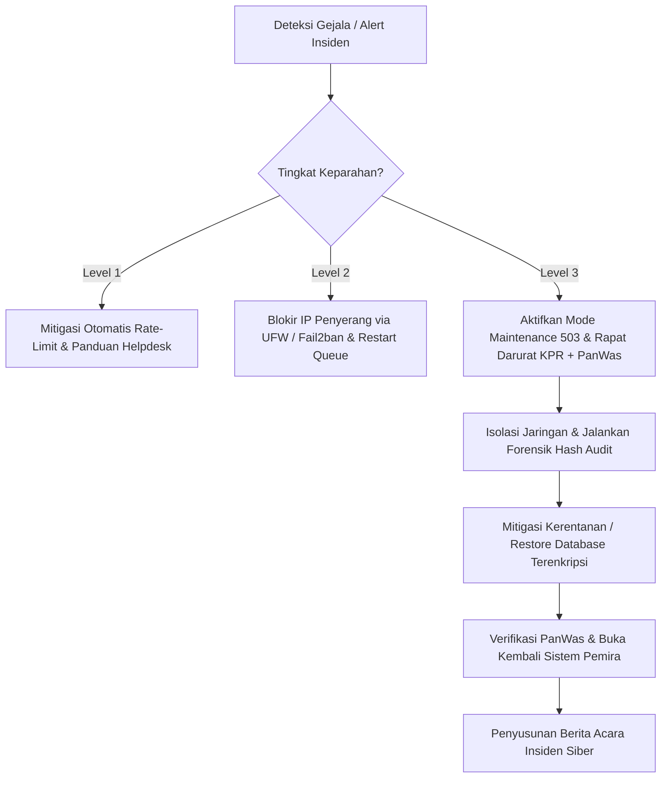

# Standar Operasional Prosedur (SOP) Tanggap Darurat & Penanganan Insiden Keamanan Siber
**Sistem E-Voting Pemilihan Raya Mahasiswa (PEMIRA)**
**Politeknik Negeri Bengkalis**

---

## 1. Tujuan & Ruang Lingkup

Dokumen ini merupakan panduan resmi bagi Komisi Pemilihan Raya (KPR), Panitia Pengawas (PanWas), dan Tim Teknis/DevOps dalam mendeteksi, merespons, memitigasi, serta memulihkan sistem dari setiap potensi gangguan keamanan siber, kegagalan teknis, atau manipulasi data selama tahapan Pemira berlangsung.

---

## 2. Struktur Tim Tanggap Darurat Insiden Siber (CSIRT Pemira)

| Peran | Penanggung Jawab | Wewenang & Tanggung Jawab |
| :--- | :--- | :--- |
| **Incident Commander** | Ketua KPR Politeknik Negeri Bengkalis | Mengambil keputusan strategis, mengumumkan status darurat, dan koordinasi dengan pimpinan kampus. |
| **Audit & Compliance Lead** | Ketua PanWas Pemira | Memverifikasi keabsahan log forensik kriptografis, menandatangani berita acara, dan mengawasi investigasi. |
| **Technical Incident Handler** | Tim Teknis / DevOps Sysadmin | Melakukan isolasi server, mitigasi lalu lintas jaringan, analisis log, dan pemulihan data (failover/restore). |
| **Communications Officer** | Divisi Humas & Helpdesk | Menyampaikan informasi resmi kepada mahasiswa pemilih dan mencegah disinformasi / kepanikan publik. |

---

## 3. Klasifikasi Level Keparahan Insiden (Severity Levels)

### Level 1: Rendah (Low / Operational)
- **Kriteria:** Percobaan login gagal tunggal, pemilih salah memasukkan PIN/OTP, kendala jaringan lokal pemilih individual.
- **Tindakan:** Ditangani oleh sistem otomatis (rate limiting, generic error) dan tim Helpdesk standar.

### Level 2: Sedang (Medium / Warning)
- **Kriteria:** IP terdeteksi melakukan scanning/flooding ringan, antrean pengiriman email OTP mengalami kelambatan, berkas sengketa menumpuk > 50 laporan.
- **Tindakan:** Pemblokiran IP via Fail2ban / UFW, restart worker queue (`php artisan queue:restart`), eskalasi ke Technical Handler.

### Level 3: Kritis (High / Emergency)
- **Kriteria:**
  1. Serangan DDoS masif yang membuat server tidak responsif (> 5.000 req/detik).
  2. Kerusakan integritas hash audit log terdeteksi oleh `php artisan audit:verifikasi`.
  3. Indikasi peretasan atau penyalahgunaan akun Super Admin / Panitia.
  4. Kerusakan fisik server atau kegagalan basis data MySQL (*crash*).
- **Tindakan:** Deklarasi status darurat oleh Ketua KPR, aktivasi mode pemeliharaan terisolasi (503), isolasi server, investigasi forensik bersama PanWas, dan eksekusi runbook bencana.

---

## 4. Runbook Aksi Penanganan Skenario Insiden



---

### Skenario A: Serangan DDoS Masif & Flooding Lalu Lintas
1. **Langkah 1 (Aktivasi Mode Pemeliharaan Tanpa Beban DB):**
   ```bash
   php artisan down --secret="kpr-darurat-bypass-key" --refresh=15
   ```
   *Halaman statis `resources/views/errors/503.blade.php` akan disajikan langsung tanpa melakukan query ke basis data.*
2. **Langkah 2 (Mitigasi Nginx & Rate Limiting):**
   - Periksa IP penyerang dengan koneksi terbanyak:
     ```bash
     sudo netstat -ntu | awk '{print $5}' | cut -d: -f1 | sort | uniq -c | sort -n
     ```
   - Terapkan rate limit ketat pada blok server Nginx (`limit_req_zone`).
3. **Langkah 3 (Blokir Subnet Penyerang via Firewall):**
   ```bash
   sudo ufw insert 1 deny from <IP_PENYERANG> to any
   ```
4. **Langkah 4:** Aktifkan proteksi "Under Attack Mode" pada Cloudflare/Reverse Proxy jika menggunakan CDN kampus.

---

### Skenario B: Serangan Brute Force & Enumerasi Akun Mahasiswa
1. **Verifikasi Pertahanan Aplikasi:**
   - Aplikasi secara otomatis menerapkan *constant-time dummy hashing* dan pesan kesalahan seragam: `"NIM atau kata sandi/PIN tidak cocok atau belum terdaftar."`
2. **Periksa Percobaan Gagal Berulang di Log:**
   ```bash
   grep "LOGIN_FAILED" storage/logs/laravel.log | tail -n 50
   ```
3. **Karantina IP Penyerang:**
   Jika satu IP melakukan percobaan > 20 kali dalam 5 menit, masukkan IP tersebut ke blacklist permanen UFW:
   ```bash
   sudo fail2ban-client set nginx-botsearch banip <IP_PENYERANG>
   ```

---

### Skenario C: Deteksi Anomali / Kerusakan Rantai Hash Log Audit
1. **Jalankan Verifikasi Rantai Kriptografis Segera:**
   ```bash
   php artisan audit:verifikasi
   ```
2. **Jika Ditemukan Kerusakan Rantai (*Hash Mismatch*):**
   - Catat ID rekaman log audit yang mengalami diskrepansi.
   - Periksa tabel `audit_logs` pada baris tersebut untuk melihat apakah ada modifikasi langsung (*direct SQL update*) pada basis data.
   - Panggil **Ketua PanWas** untuk menyaksikan bukti forensik digital.
   - Identifikasi waktu kejadian dan periksa log akses server (`/var/log/nginx/access.log` dan `/var/log/auth.log`).
3. **Langkah Mitigasi:**
   - Kunci akses remote MySQL (`bind-address = 127.0.0.1`).
   - Ubah seluruh kredensial database (`DB_PASSWORD`).
   - Buat penanda forensik resmi pada Berita Acara Insiden PanWas.

---

### Skenario D: Kompromi Akun Admin / Akses Tidak Sah
1. **Putus Seluruh Sesi Aktif Admin:**
   Jalankan perintah pengosongan session admin pada Redis/Database:
   ```bash
   # Jika menggunakan database session:
   php artisan session:clear-admin-sessions
   ```
2. **Nonaktifkan Akun Terkompromi:**
   ```bash
   php artisan tinker --execute="App\Models\User::where('username', 'target_admin')->update(['is_active' => false]);"
   ```
3. **Reset Kunci Rahasia 2FA & Password:**
   Admin yang bersangkutan wajib menghadap langsung ke Ketua KPR untuk verifikasi fisik sebelum akun dipulihkan dengan kata sandi baru dan pendaftaran ulang TOTP Google Authenticator.

---

### Skenario E: Kerusakan Basis Data & Prosedur Disaster Recovery (Restore)
1. **Identifikasi Cadangan Terenkripsi Harian Terakhir:**
   Cadangan otomatis dibuat setiap hari pukul 02:00 WIB di direktori aman / offsite:
   ```bash
   ls -la /var/backups/evoting/
   ```
2. **Dekripsi Berkas Backup AES-256:**
   ```bash
   openssl enc -d -aes-256-cbc -pbkdf2 -in /var/backups/evoting/backup_2026_10_12.sql.enc -out /tmp/restore.sql -pass env:BACKUP_ENCRYPTION_KEY
   ```
3. **Pulihkan Skema & Data:**
   ```bash
   mysql -u root -p evoting_kampus < /tmp/restore.sql
   rm /tmp/restore.sql
   ```
4. **Verifikasi Integritas:**
   Jalankan `php artisan audit:verifikasi` dan verifikasi total suara per kategori bersama saksi paslon dan PanWas.

---

### Skenario F: Sengketa Akun & Klaim Kepemilikan Ganda di Lapangan
1. Pelapor mengajukan form sengketa resmi di `/nim-status/sengketa` disertai unggahan bukti foto KTM asli.
2. Petugas Helpdesk A memeriksa kesesuaian identitas fisik/kartu mahasiswa dan menandai "Sedang Diproses".
3. Petugas Helpdesk B melakukan *second-approval* (persetujuan 2-petugas independen).
4. Akun lama dicabut secara kriptografis, dan kode pendaftaran baru diterbitkan satu kali via layar flash session petugas.

---

## 5. Saluran Eskalasi & Matriks Kontak Darurat

- **Pusat Bantuan WhatsApp Helpdesk Pemira:** `+62 851-8795-3580`
- **Email Insiden Siber KPR:** `pemira-darurat@polbeng.ac.id`
- **Sekretariat PanWas Pemira:** Gedung Pusat Kegiatan Mahasiswa (PKM) Lt. 2, Politeknik Negeri Bengkalis.

---

## 6. Format Berita Acara Insiden Siber Pemira

Setiap penanganan insiden Level 2 dan Level 3 WAJIB dituangkan dalam formulir Berita Acara resmi yang ditandatangani bersama oleh:
1. **Ketua Komisi Pemilihan Raya (KPR)**
2. **Ketua Panitia Pengawas (PanWas)**
3. **Kepala Tim Teknis / DevOps**

*Format Berita Acara mencakup: Tanggal & Waktu Kejadian, Gejala Insiden, Dampak terhadap Pemungutan Suara, Aksi Penanganan Teknis yang Dilakukan, Hasil Verifikasi Audit Log Kriptografis, dan Status Akhir Sistem.*
