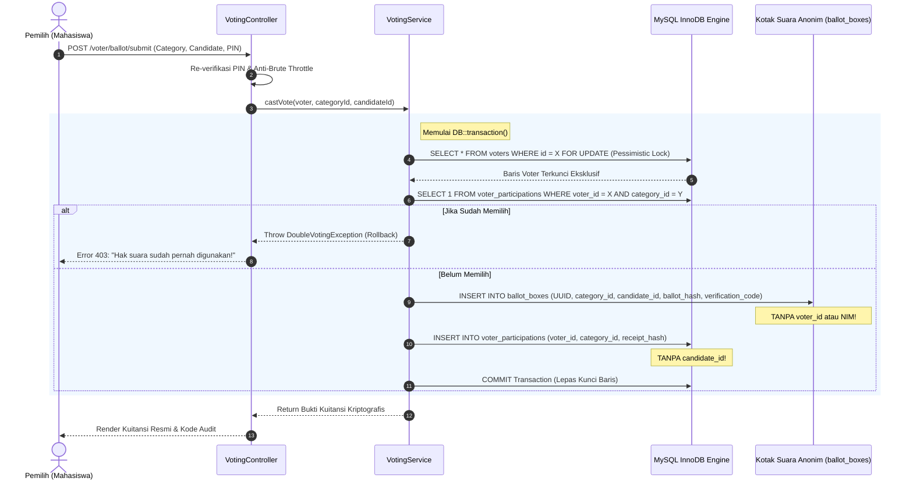

# Arsitektur Keamanan Sistem E-Voting Kampus Anti-Kecurangan

Dokumentasi spesifikasi keamanan tingkat tinggi (Military/Banking-Grade Security) untuk sistem pemilihan umum mahasiswa (*PEMIRA*) berbasis Laravel & MySQL.

---

## 1. Analisis Model Ancaman (Threat Modeling)

Dalam perancangan sistem e-voting kampus, terdapat 4 vektor serangan krusial yang ditangani secara ketat:

| Ancaman / Vektor Serangan | Metode Penyerangan | Mitigasi Arsitektural dalam Sistem Ini |
| :--- | :--- | :--- |
| **Race Condition / Double Voting** | Mahasiswa mengeksekusi 50 HTTP POST secara paralel via script (cURL/Burp Suite) dalam milidetik yang sama sebelum `has_voted` di-commit. | **Pessimistic Locking (`lockForUpdate()`)** di dalam `DB::transaction()` + **Unique Constraint InnoDB** `(voter_id, election_category_id)`. |
| **Pelanggaran Rahasia Suara (Secret Ballot)** | Admin/DBA men-dump database untuk melihat calon yang dipilih oleh NIM tertentu. | **Pemisahan Mutlak (Decoupled Ballot Box)**: Tabel `ballot_boxes` **TIDAK MEMILIKI** kolom `voter_id` atau relasi foreign key apapun ke pemilih. UUIDv4 acak digunakan sebagai Primary Key. |
| **Kecurangan Perhitungan (Fraudulent Tallying)** | Panitia nakal menyisipkan suara palsu atau mengubah perolehan suara. | **Audit Kuitansi Kriptografis (Zero-Knowledge Verifiable Receipt)**: Setiap pemilih mendapatkan `verification_code` dan `ballot_hash` unik yang bisa diverifikasi secara publik tanpa membocorkan pilihannya. |
| **Session Hijacking & Brute Force** | Pembajakan sesi mahasiswa di komputer laboratorium kampus / tebak PIN. | **Re-autentikasi PIN sebelum submit final**, **Anti-Brute Force Rate Limiting (5 percobaan/5 menit)**, dan **Regenerasi Session ID**. |

---

## 2. Diagram Alur Transaksi & Anti-Race Condition

---

## 3. Protokol Pemisahan Kriptografis (Secret Ballot Engine)

Untuk menjaga asas **LUBER JURDIL** (Langsung, Umum, Bebas, Rahasia, Jujur, dan Adil):

1. **Tabel Presensi Pemilih (`voter_participations`)**:
   - Mencatat **BAHWA** NIM tertentu telah hadir dan memilih pada kategori terkait.
   - Kolom yang disimpan: `voter_id`, `election_category_id`, `voted_at`, `ip_address`, `receipt_hash`.
   - **TIDAK MENYIMPAN** pilihan paslon.
2. **Tabel Kotak Suara Anonim (`ballot_boxes`)**:
   - Berisi surat suara digital yang dimasukkan ke kotak suara.
   - Kolom yang disimpan: `id` (UUIDv4), `election_category_id`, `candidate_id`, `verification_code`, `ballot_hash`.
   - **SAMA SEKALI TIDAK MENYIMPAN** identitas mahasiswa (`voter_id` atau `nim`).
   - Bahkan jika database disita atau bocor ke publik, tidak ada korelasi relasional yang dapat menghubungkan NIM tertentu dengan kandidat yang dipilihnya.
3. **Audit Kuitansi Independen**:
   - Pemilih menerima kode verifikasi (contoh: `PEMIRA-7X9K-Q4M2`).
   - Melalui halaman publik `/verify-ballot`, pemilih dapat memasukkan kode ini untuk mengonfirmasi bahwa suaranya telah tercatat sah di dalam kotak suara, tanpa mengekspos pilihannya kepada orang lain.
